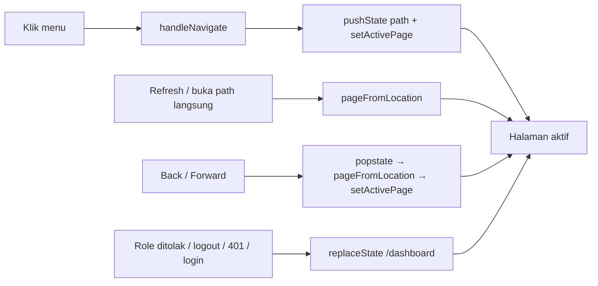

# Low-Level Plan: Navigasi Menu yang Mengubah Halaman di URL

**Document ID:** `PLAN-URL-PAGE-NAVIGATION-20261119`
**Branch:** `backend-page` (basis `a1f7baf`; dilarang `main`)
**Status:** Rencana, belum diimplementasikan.

---

## 1. Masalah & Akar

| Gejala terukur | Bukti |
|---|---|
| Klik menu mengganti halaman tanpa mengubah URL | `src/app/App.tsx:1460-1465` memanggil `handleNavigate(item.id)`; `:1371-1375` hanya `setActivePage(page as Page)` |
| Refresh selalu kembali ke dashboard/default | `src/app/App.tsx:1325` — `useState<Page>("dashboard")` menjadi satu-satunya sumber halaman; `main.tsx:7` merender ulang dari nol |
| Back/forward browser tidak berpengaruh | Tidak ada `history.pushState`, `popstate`, atau router di `package.json` |
| Dokumentasi menyatakan rute bukan URL | `docs/web-flow-viewer.md:48`, `:125`, `:183` |

**Akar:** identitas halaman hanya hidup di state React, tidak di URL. Tidak ada ketergantungan router yang perlu dipasang—cukup History API bawaan browser.

---

## 2. Keputusan Desain

### D1. Pathname sebagai identitas halaman

`/dashboard`, `/course-finder`, `/pj-courses`, `/degree-planner`, `/chatbot`, `/profile`, `/admin-accounts`. `/` tetap alias dashboard. Path tak dikenal → dashboard dengan `replaceState` ke `/dashboard`.

Alasan: path bisa di-bookmark dan dibagikan; query param `?page=` lebih sulit dibaca dan tidak perlu. Vite dev server (dipakai juga di `Dockerfile.frontend:27` lewat `pnpm dev`) melakukan fallback ke `index.html` untuk permintaan HTML; `index.html:10` memakai path aset absolut `/src/app/main.tsx`, sehingga aset tetap termuat dari subpath. Asumsi ini diverifikasi dengan `curl` sebelum implementasi (lihat §7).

### D2. URL sebagai sumber kebenaran, state sebagai cache

Tambahkan di `src/app/App.tsx` dekat tipe `Page` (`:78`):

- `PAGES` — daftar slug yang valid.
- `pageFromLocation()` — `location.pathname` dipangkas slash; anggota `PAGES` → halaman itu; selainnya (termasuk `/`) → `dashboard`.
- `pageUrl(page)` — `/${page}`.

Di `AppShell` (`:1325`), inisialisasi `useState<Page>(pageFromLocation)`. Satu fungsi `navigate(page, replace = false)` melakukan `history.pushState`/`replaceState` **dan** `setActivePage`, lalu dipakai oleh semua jalur yang sekarang memanggil `setActivePage`. Efek `popstate` menyamakan state dari `location` saat Back/Forward. Tidak ada router baru, tidak ada store tambahan.

### D3. `replaceState` untuk redirect paksa, `pushState` untuk klik menu

- Klik menu / tombol navigasi → `pushState` (Back mengembalikan halaman sebelumnya).
- Role diblokir (`canAccess` false, `:1344-1346`), logout/401/expired (`:1347-1354`, `:1382-1389`), login (`:1422-1425`), path tak dikenal → `replaceState`, supaya riwayat tidak berisi halaman yang tidak bisa dibuka.
- Aturan akses tetap di `src/features/auth/session.tsx:187-195`; tidak diubah.

### D4. `search` dan `hash` ikut dipertahankan

URL tujuan = `pageUrl(page) + location.search + location.hash`. Ini menjaga tautan bagikan jadwal `#timetable=...` (`src/shared/timetable/timetableShare.ts:124-157`) dan pembacaannya saat mount (`TimetableGrid.tsx:69-75`). Tombol "Dismiss shared" (`TimetableGrid.tsx:122-134`) sudah memakai `pathname + search`, jadi tetap benar setelah path berubah.

### D5. Perilaku sesi dengan deep link

`SessionProvider` membaca token/user dari `localStorage` secara sinkron (`session.tsx:64-69`), jadi halaman dari URL bisa diputuskan pada render pertama tanpa efek asinkron. Deep link saat belum login menampilkan Login di path tersebut; setelah login, halaman di-set ke dashboard dengan `replaceState` (perilaku lama dipertahankan). Mengembalikan halaman yang diminta setelah login adalah pekerjaan terpisah.

### D6. Lingkup perubahan

`src/app/App.tsx`, `docs/web-flow-viewer.md`, dan modul sesi/akses (`src/features/auth/session.tsx`) untuk menjadikan `pj-courses` hanya bisa diakses lecturer. Item sidebar dan blok identitas profil juga diubah menjadi tautan asli (`<a href={pageUrl(...)}>`): klik kiri tanpa modifier dicegat untuk navigasi dalam aplikasi, klik dengan modifier dibiarkan membuka tab baru. Komponen halaman lain dan `ErrorBoundary key={activePage}` tidak berubah.

---

## 3. Peta Rute

| Page | Path | Diakses oleh |
|---|---|---|
| `dashboard` | `/dashboard` (`/` alias) | semua peran |
| `course-finder` | `/course-finder` | student, admin (label "Course Management") |
| `pj-courses` | `/pj-courses` | lecturer |
| `degree-planner` | `/degree-planner` | student |
| `chatbot` | `/chatbot` | student |
| `profile` | `/profile` | semua peran |
| `admin-accounts` | `/admin-accounts` | admin |

---

## 4. Detail Perubahan

### `src/app/App.tsx`

1. `:78` — tambah `PAGES`, `pageFromLocation()`, `pageUrl(page)`. Tipe `Page` tetap.
2. `:1325` — `useState<Page>(pageFromLocation)`.
3. Tambah efek pemasang listener `popstate` di dekat `:1355`; bersihkan listener pada unmount (StrictMode memasang dua kali di dev). Efek mount menyamakan path tak dikenal dengan `replaceState`.
4. `:1344-1346` — redirect role ditolak memakai `navigate("dashboard", true)`.
5. `:1347-1354` — efek logout/401 membersihkan state chat **dan** `navigate("dashboard", true)`.
6. `:1365-1375` — `handleNavigate(page: string, options?)`: validasi `page` lewat `PAGES` (invalid → `dashboard`), pertahankan `plannerInitialTab`/`finderInitialCourse`, lalu `navigate(validPage)`. Opsi tab/kursus tetap state transien, tidak masuk URL.
7. `:1382-1389` (`handleLogout`) dan `:1422-1425` (`onLogin`) — ganti `setActivePage` dengan `navigate(..., true)`.
8. Item sidebar (`:1460-1465`) dan blok identitas profil (`:1498-1503`) diubah dari tombol menjadi `<a href={pageUrl(...)}>`; klik kiri tanpa modifier dicegat untuk `handleNavigate`, klik dengan modifier/meta dibiarkan membuka tab baru.
9. `navigate` didefinisikan dengan `useCallback` agar aman dipakai di dependency efek.

### `docs/web-flow-viewer.md`

- `:48` — `activePage state` → `pathname ↔ activePage state`.
- `:125` — jelaskan `handleNavigate` melakukan `pushState` + `setActivePage`, `popstate` melakukan sebaliknya.
- `:158`, `:172-183` — alur login/logout menulis `/dashboard` dengan `replaceState`; hapus kalimat "Aturan rute bukan URL, melainkan state".

---

## 5. Diagram Alur

---

## 6. Risiko & Mitigasi

| Risiko | Mitigasi |
|---|---|
| Refresh `/degree-planner` 404 di server statis | Vite fallback; verifikasi dengan `curl` (§7). Jika deploy ke server statis lain, perlu konfigurasi fallback ke `index.html` |
| Tautan `#timetable=` rusak | `search` + `hash` ikut disalin saat navigasi; tidak ada `replaceState` yang membuang hash kecuali `handleDismissShared` yang memang disengaja |
| State dan URL beda saat Back/Forward | `popstate` satu-satunya jalur pembaca URL; semua penulisan lewat `navigate` |
| Riwayat penuh redirect | `replaceState` untuk semua redirect paksa |
| Efek StrictMode jalan dua kali | unsubscribe listener di cleanup; `navigate` stabil dengan `useCallback` |

---

## 7. Kriteria Verifikasi

1. `pnpm install` lalu `curl -s -o /dev/null -w '%{http_code}' -H 'Accept: text/html' http://localhost:8443/degree-planner` → `200` dengan body `index.html` (jalankan `pnpm dev` saat pengujian). Ulangi untuk `/admin-accounts`.
2. `pnpm typecheck` dan `pnpm build` sukses; `pnpm format:check` bersih.
3. Browser `http://localhost:8443`: login → klik tiap menu → URL berubah sesuai peta rute → refresh → halaman tetap sama dan sidebar menu aktif sesuai.
4. Back/forward: tiga kali pindah menu lalu Back dua kali → URL dan halaman kembali sinkron.
5. Buka tab baru di `/chatbot` dengan sesi masih aktif → Compass AI langsung tampil. Buka `/admin-accounts` sebagai student → redirect ke `/dashboard` dengan URL ikut berubah.
6. Logout dari `/profile` → URL `/dashboard`; tombol Back tidak kembali ke `/profile`.
7. Salin tautan jadwal dari Degree Planner (`#timetable=`), refresh, lalu pindah menu dan kembali → jadwal sharing tetap terbaca; tombol "Dismiss" menghapus hash tanpa mengubah path halaman.

---

## 8. Non-Goal

- Tidak memasang `react-router`.
- Tidak memindahkan tab roadmap/timetable, course detail, riwayat chat, atau draft planner ke URL (draft planner sudah tersimpan di server).
- Tidak mengubah aturan akses lain selain menjadikan Rekap & Kelola MK (`pj-courses`) lecturer-only, dan tidak mengubah alur login.

Commit lokal per tahap. Dilarang `git push`.
